# Jak s aplikací pracovat — mapy postupů

Vyber si postup podle cíle. Grafy jsou vložené jako **PNG obrázky** i pro mobilní
GitHub; odkaz **SVG** otevře vektorovou verzi pro zvětšení. **Mermaid** je upravitelný zdroj.

Obdélník je krok, kosočtverec rozhodnutí. Doporučené pořadí není vždy podmínkou
uložení; automatické akce jsou v grafu výslovně popsané. Administrace vyžaduje PIN,
hostovský POS zůstává veřejný.

| Oblast | Postupy |
| --- | --- |
| Orientace a pobyty | [01. Mapa aplikace](#01-mapa-aplikace) · [02. Rezervace](#02-rezervace) · [03. Import rezervací](#03-import-rezervací) |
| Kuchyň | [04. Stravování a nákup](#04-stravování-a-nákup) |
| Pobytové finance | [05. Kalkulace a zálohová výzva](#05-kalkulace-a-zálohová-výzva) · [06. Zálohy a konečné vyúčtování](#06-zálohy-a-konečné-vyúčtování) · [07. Opravy a vratky](#07-opravy-a-vratky) · [08. PDF a odeslání dokladů](#08-pdf-a-odeslání-dokladů) |
| ABRA a banka | [09. Potvrzení bankovní platby](#09-potvrzení-bankovní-platby) · [10. Přenosy do ABRA](#10-přenosy-do-abra) |
| Bar a zásoby | [11. Barová spotřeba](#11-barová-spotřeba) · [12. Zaplacení baru](#12-zaplacení-baru) · [13. Produkty a ceny](#13-produkty-a-ceny) · [14. Barový sklad](#14-barový-sklad) · [15. Celkový sklad a naskladnění](#15-celkový-sklad-a-naskladnění) |
| Komunikace a přehledy | [16. Emaily hostům](#16-emaily-hostům) · [17. Přehledy a statistiky](#17-přehledy-a-statistiky) · [18. Export do POHODA](#18-export-do-pohoda) |

## 01. Mapa aplikace

Rezervace propojuje samostatné agendy. Větve této mapy ukazují vztahy, ne povinné pořadí práce.

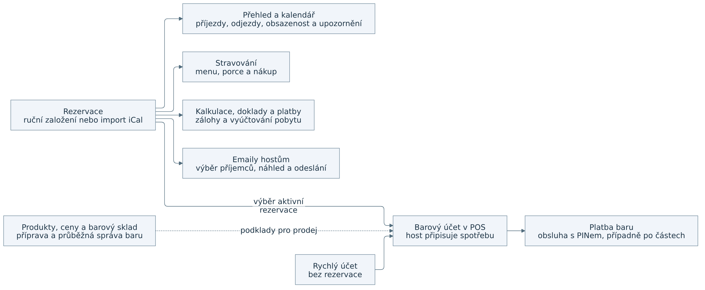

[SVG](workflows/01-overview.svg) · [PNG](workflows/01-overview.png) · [Mermaid](workflows/01-overview.mmd) · [Podrobný návod: Administrace](ADMINISTRATION.md)

## 02. Rezervace

Začátek: **Přehled → Rezervace**. Obsazenost, stravování a finanční evidence mají vlastní podklady. Zrušení rezervace nevrací peníze.

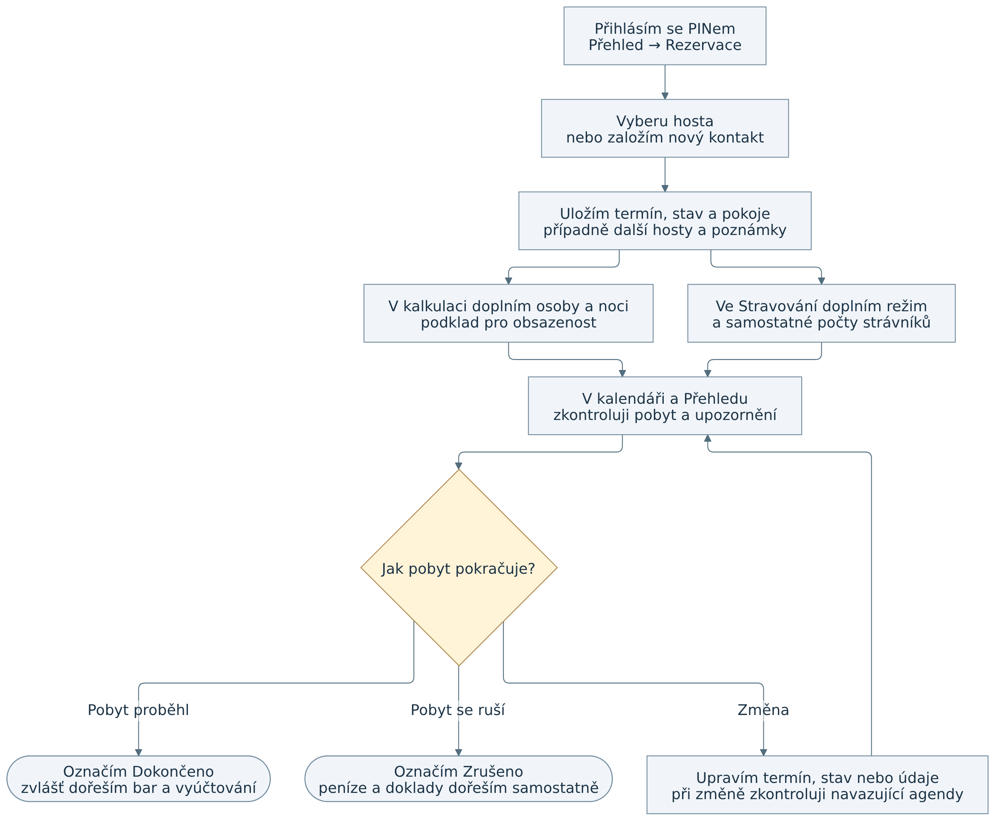

[SVG](workflows/02-reservations.svg) · [PNG](workflows/02-reservations.png) · [Mermaid](workflows/02-reservations.mmd) · [Podrobný návod: Kalendář a rezervace](CALENDAR_VIEW.md)

## 03. Import rezervací

Začátek: **Další agenda → Pobyty a hosté → Import rezervací**. Jednorázový import souboru; existující rezervace nepřepisuje a není obousměrnou synchronizací.

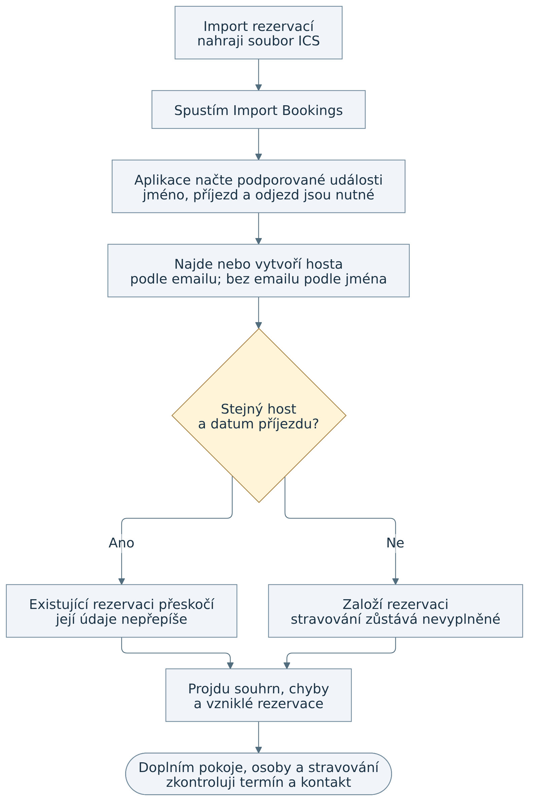

[SVG](workflows/03-ical-import.svg) · [PNG](workflows/03-ical-import.png) · [Mermaid](workflows/03-ical-import.mmd) · [Podrobný návod: Import iCal](../integrations/ICAL_IMPORT.md)

## 04. Stravování a nákup

Začátek: **Detail rezervace → Stravování**. Menu lze připravit před znalostí počtů, ale pro porce a nákup vyplň oba počty včetně nul. Seznam s upozorněními může být neúplný.

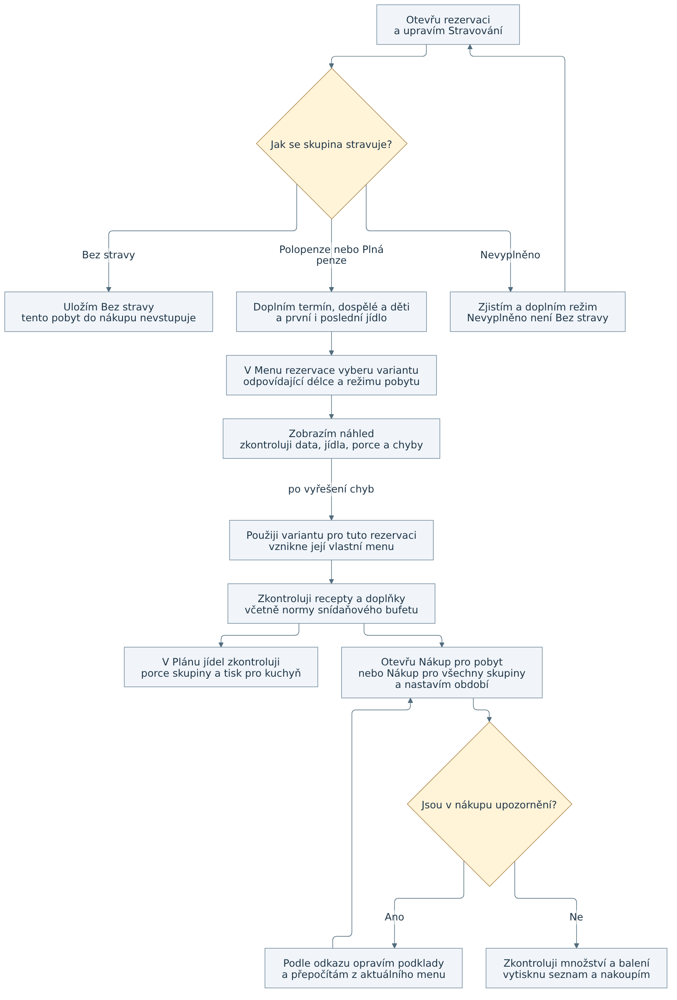

[SVG](workflows/04-catering.svg) · [PNG](workflows/04-catering.png) · [Mermaid](workflows/04-catering.mmd) · [Podrobný návod: Stravování, receptury a nákup](CATERING.md)

## 05. Kalkulace a zálohová výzva

Začátek: **Detail rezervace → Otevřít kalkulaci, doklady a platby**. Ceník vybírá ceny podle příjezdu; jeho pozdější změna sama nepřecení kalkulaci ani vydané doklady.

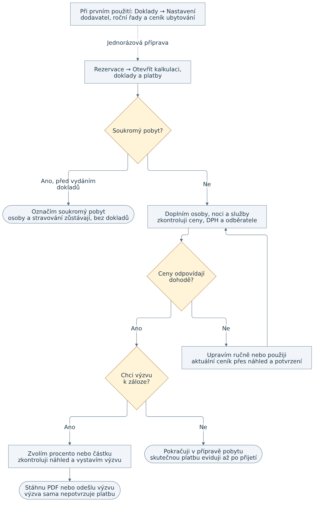

[SVG](workflows/05-calculation-advance.svg) · [PNG](workflows/05-calculation-advance.png) · [Mermaid](workflows/05-calculation-advance.mmd) · [Podrobný návod: Fakturace pobytů](BILLING.md)

## 06. Zálohy a konečné vyúčtování

Začátek: **Kalkulace, doklady a platby**. Pro zapojené bankovní platby použij postup 09. Pozdě nalezenou platbu před DUZP nelze jednoduše zapsat jako doplatek.

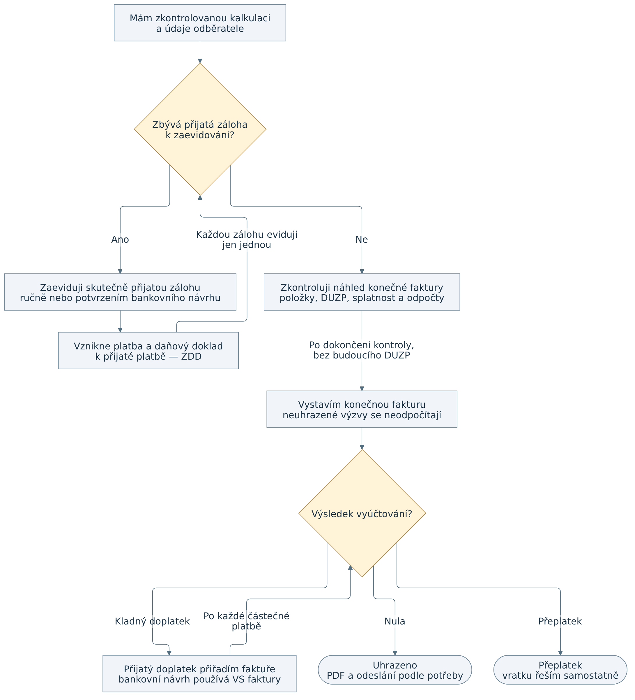

[SVG](workflows/06-final-settlement.svg) · [PNG](workflows/06-final-settlement.png) · [Mermaid](workflows/06-final-settlement.mmd) · [Podrobný návod: Fakturace pobytů](BILLING.md)

## 07. Opravy a vratky

Začátek: **Detail dokladu**. Vydaný doklad se nepřepisuje. Převod peněz provádíš mimo aplikaci; pobyty s opravou nebo vratkou vyžadují samostatné účetní řešení přenosu do ABRA.

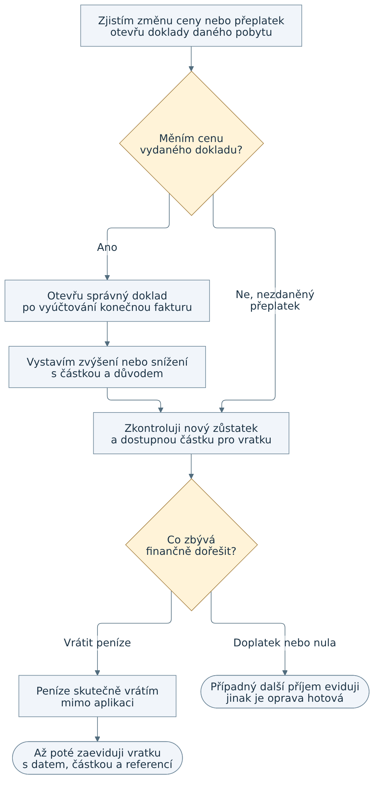

[SVG](workflows/07-corrections-refunds.svg) · [PNG](workflows/07-corrections-refunds.png) · [Mermaid](workflows/07-corrections-refunds.mmd) · [Podrobný návod: Opravy a vratky](BILLING.md#opravy-a-vratky)

## 08. PDF a odeslání dokladů

Začátek: **Doklady v kalkulaci pobytu**. Stažení i email používají původní uložené PDF. Příjemce a zprávu zkontroluj před každým novým odesláním.

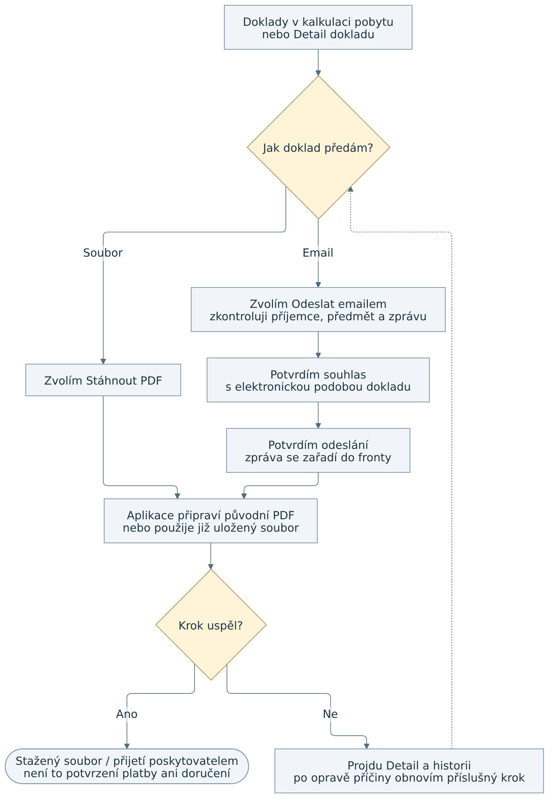

[SVG](workflows/08-document-delivery.svg) · [PNG](workflows/08-document-delivery.png) · [Mermaid](workflows/08-document-delivery.mmd) · [Podrobný návod: PDF a pošta](BILLING.md#pdf-pošta-a-provoz)

## 09. Potvrzení bankovní platby

Začátek: **Doklady → Bankovní pohyby**; vyžaduje zapojenou a nastavenou integraci. Návrh podle VS není platba. Přeplatky, možné duplicity a nesoulady nejdřív prověř.

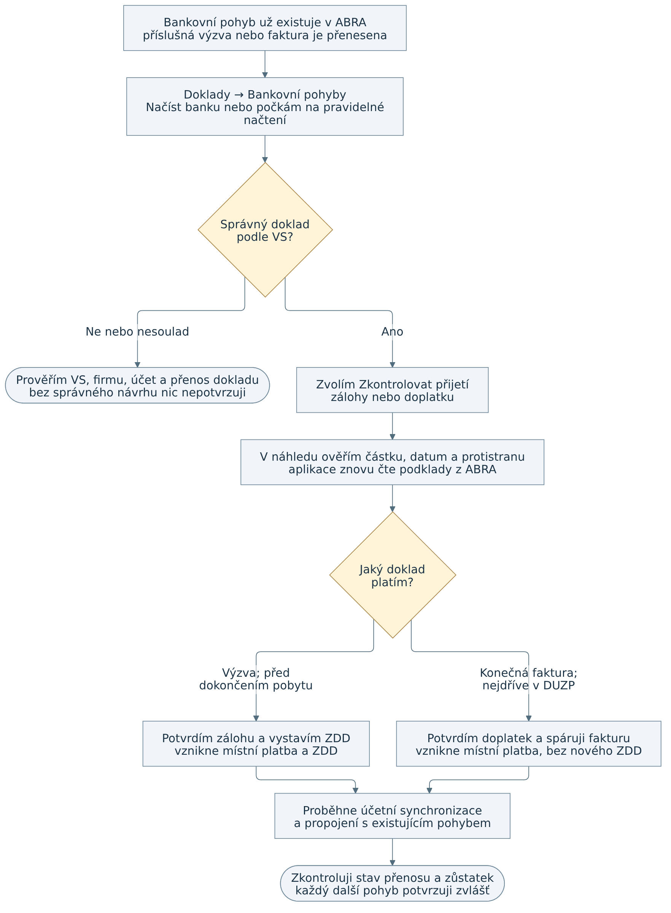

[SVG](workflows/09-bank-confirmation.svg) · [PNG](workflows/09-bank-confirmation.png) · [Mermaid](workflows/09-bank-confirmation.mmd)

## 10. Přenosy do ABRA

Začátek: **Doklady → Přenosy do ABRA**. Automaticky se řadí podporované výzvy a vyúčtování zapojených nových pobytů. Odpočítávané ZDD musí mít dokončené účetní vazby; ručně evidované doplatky, opravy a vratky mohou export vyúčtování blokovat.

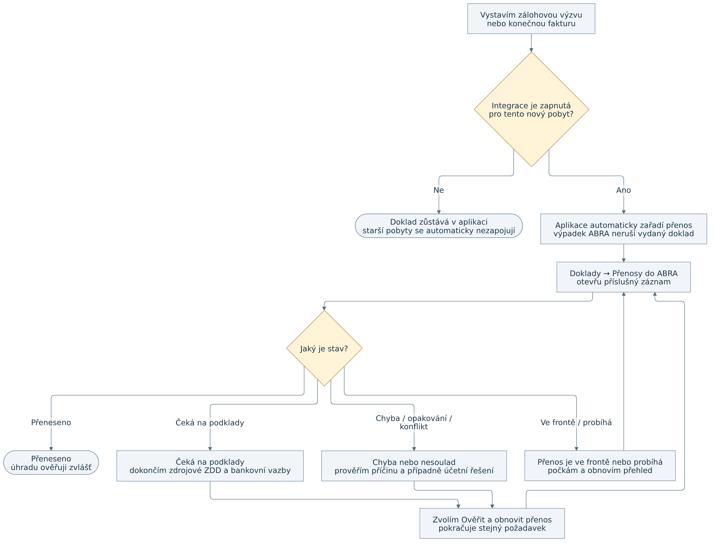

[SVG](workflows/10-abra-transfers.svg) · [PNG](workflows/10-abra-transfers.png) · [Mermaid](workflows/10-abra-transfers.mmd)

## 11. Barová spotřeba

Začátek: **POS**. Servisní režim označuje nestandardní účty; sám nezavádí jinou cenu ani osvobození od placení. Historická cena a DPH zůstávají u připsané položky.

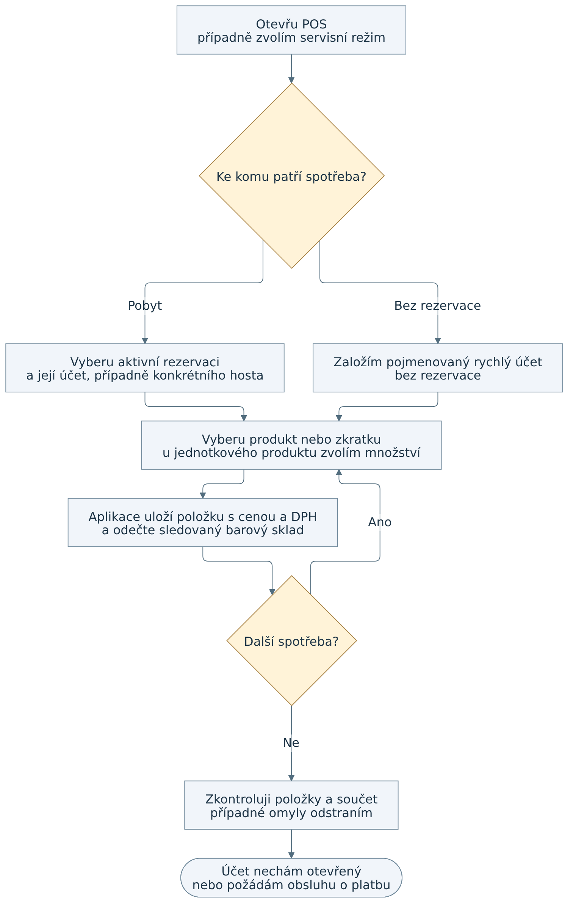

[SVG](workflows/11-pos-account.svg) · [PNG](workflows/11-pos-account.png) · [Mermaid](workflows/11-pos-account.mmd) · [Podrobný návod: Samoobslužný bar](POS_SYSTEM.md)

## 12. Zaplacení baru

Začátek: **Účet v POS → Platba nebo rozdělení účtu**. QR náhled nezapisuje platbu ani automaticky neověřuje banku. Platba baru neuhradí pobyt.

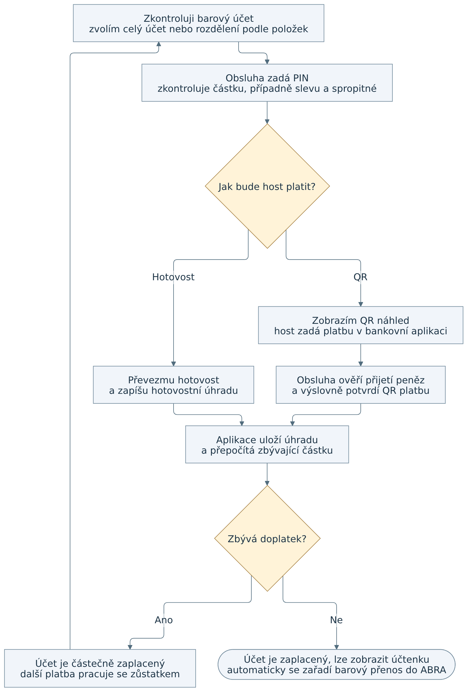

[SVG](workflows/12-pos-payment.svg) · [PNG](workflows/12-pos-payment.png) · [Mermaid](workflows/12-pos-payment.mmd) · [Podrobný návod: Barové platby](PAYMENT_FUNCTIONALITY.md)

## 13. Produkty a ceny

Začátek: **Další agenda → Produkty a ceny**. Barový ceník a ceník ubytování jsou oddělené. Změna ceny v katalogu nemění staré položky účtů.

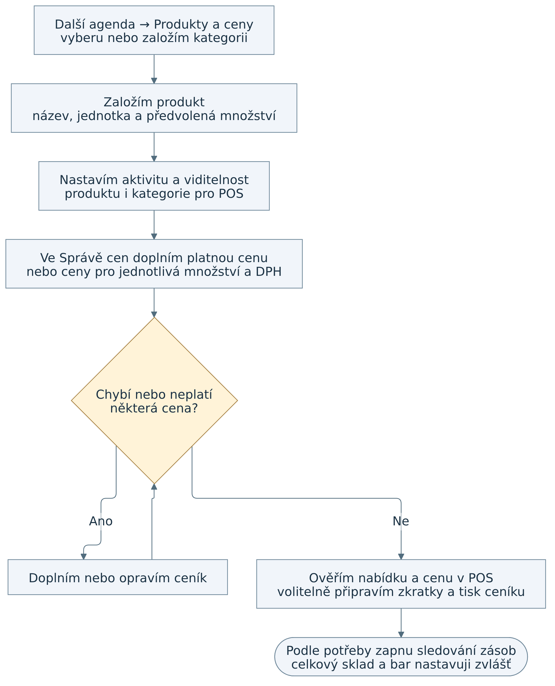

[SVG](workflows/13-catalog-prices.svg) · [PNG](workflows/13-catalog-prices.png) · [Mermaid](workflows/13-catalog-prices.mmd) · [Podrobný návod: Výběr produktu v ceníku](AUTOCOMPLETE_FEATURE.md)

## 14. Barový sklad

Začátek: **Barový sklad**. Sleduje se odděleně od celkového skladu. Odebrání připsané položky vrací evidovanou barovou spotřebu; fyzickou ztrátu zapiš jako odpis.

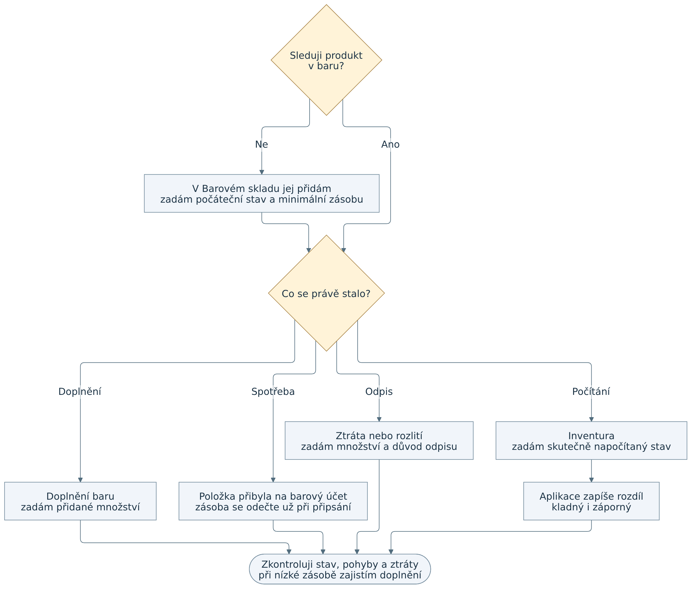

[SVG](workflows/14-bar-stock.svg) · [PNG](workflows/14-bar-stock.png) · [Mermaid](workflows/14-bar-stock.mmd)

## 15. Celkový sklad a naskladnění

Začátek: **Další agenda → Skladová evidence**. Rychlé naskladnění ukládá nulové nákupní ceny; pro ocenění doplň nákupní ceny. Doplnění baru není automatický převod mezi sklady.

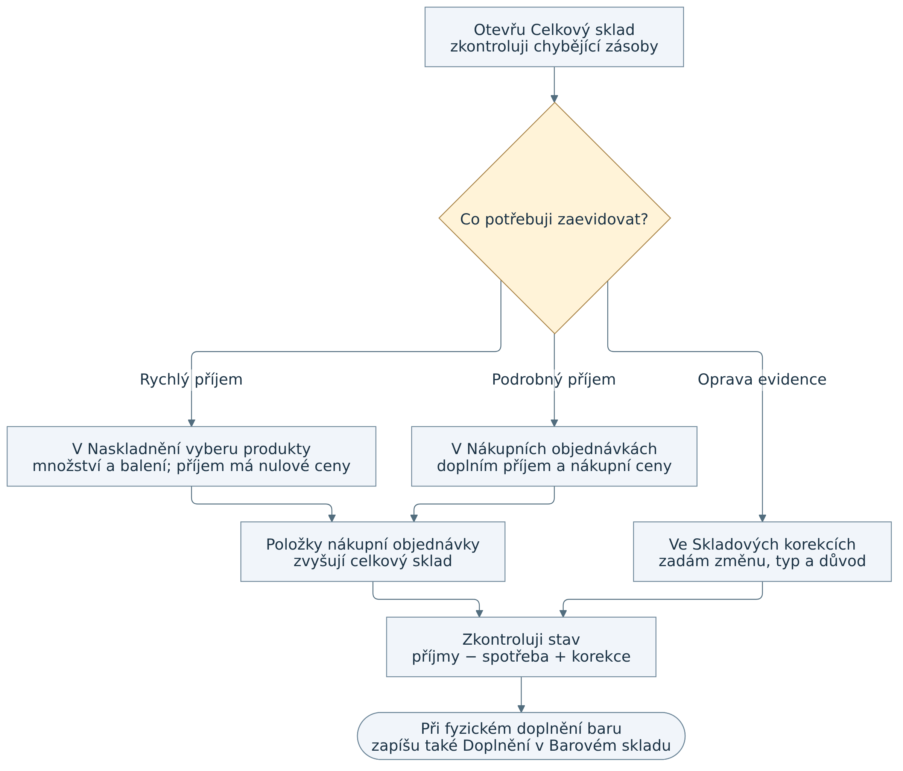

[SVG](workflows/15-total-stock.svg) · [PNG](workflows/15-total-stock.png) · [Mermaid](workflows/15-total-stock.mmd)

## 16. Emaily hostům

Začátek: **Emaily hostům**. Jde o informační zprávy, odesílání dokladů je v postupu 08. Přijetí poskytovatelem nepotvrzuje doručení do schránky hosta.

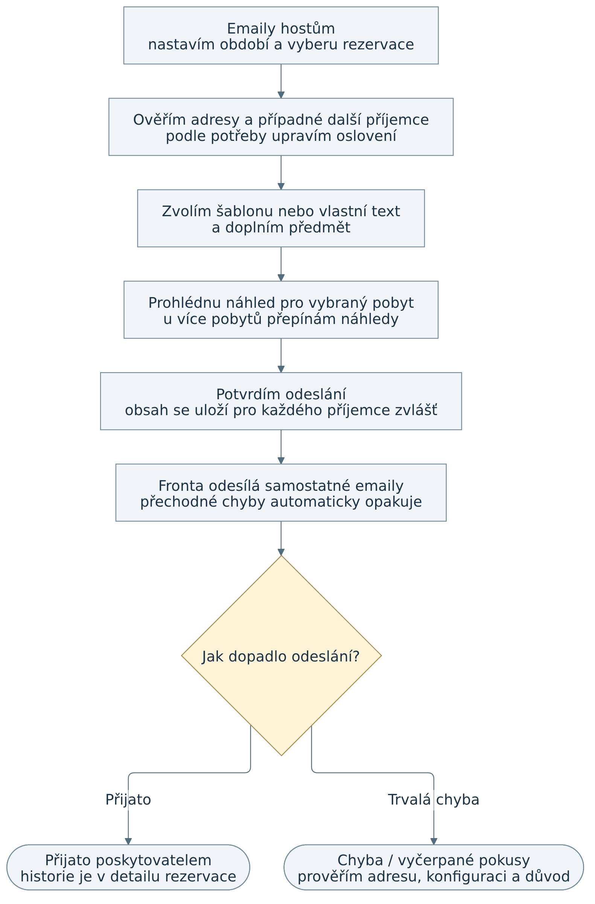

[SVG](workflows/16-guest-emails.svg) · [PNG](workflows/16-guest-emails.png) · [Mermaid](workflows/16-guest-emails.mmd) · [Podrobný návod: Emaily hostům](GUEST_EMAILS.md)

## 17. Přehledy a statistiky

Začátek podle cíle v grafu. Statistiky baru filtrují stavy účtů a servisní režim; nepovažuj celý zobrazený prodej automaticky za přijaté peníze.

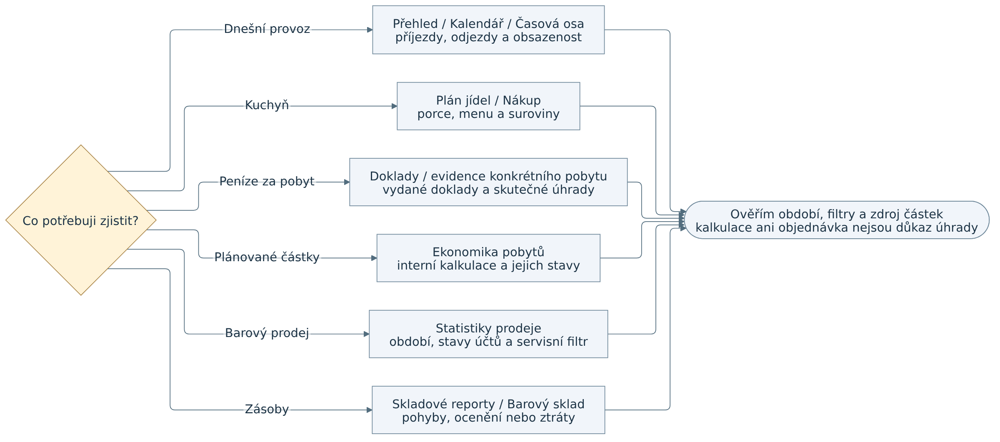

[SVG](workflows/17-reports.svg) · [PNG](workflows/17-reports.png) · [Mermaid](workflows/17-reports.mmd)

## 18. Export do POHODA

Začátek: **Další agenda → Finance a přehledy → Export POHODA**. Jen barové účty. Období se řídí vznikem účtu; aplikace neeviduje, zda byl soubor již importován do POHODA.

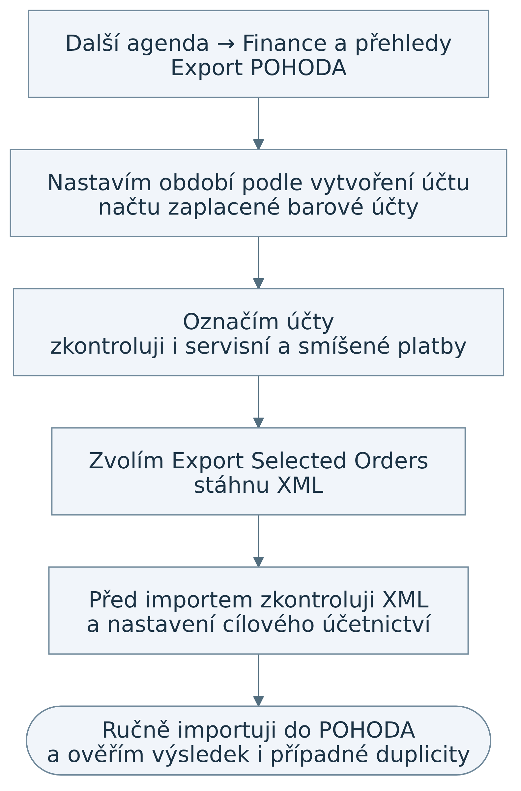

[SVG](workflows/18-pohoda.svg) · [PNG](workflows/18-pohoda.png) · [Mermaid](workflows/18-pohoda.mmd) · [Podrobný návod: Export POHODA](../integrations/POHODA_EXPORT.md)

---

Postupy vycházejí z kódu aplikace k 27. 10. 2026. Produkční nastavení integrací se může lišit.
[Technické podklady, hranice ověření a obnova obrázků](../development/WORKFLOW_DIAGRAMS.md).
