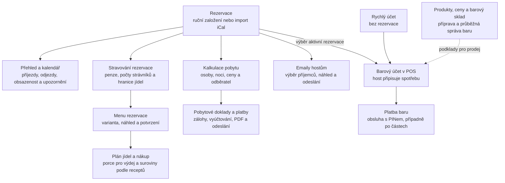
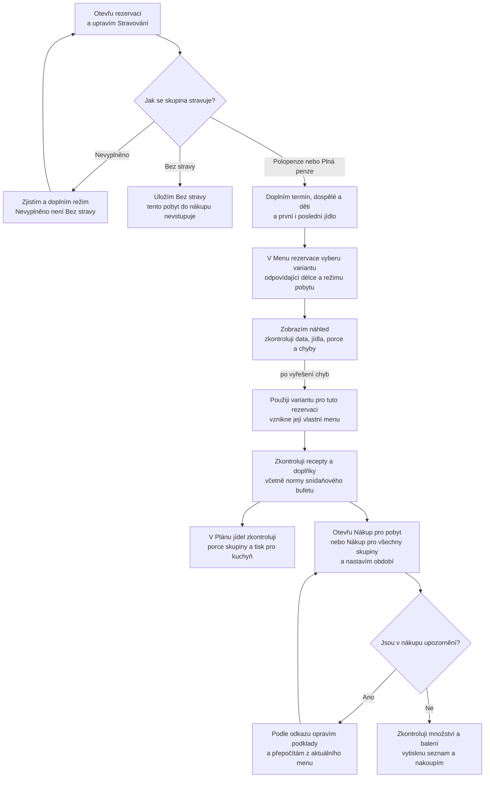

# Jak s aplikací pracovat — mapy postupů

Začněte mapou aplikace. Pro první podrobný postup následuje příprava stravování
a nákupu pro pobyt. Odkazy pod grafy vedou k podrobnějším návodům.

Grafy jsou v Mermaid a zobrazují se přímo na GitHubu. Zůstávají textem vedle
kódu, takže lze při změně chování upravit i příslušný postup.

## 1. Mapa aplikace

**Rezervace propojuje několik samostatných agend.** Větve neznamenají povinné
pořadí: menu můžete připravovat souběžně s kalkulací a komunikací s hosty.
Šipky v této mapě ukazují vztah nebo předání podkladů, nikoli automatické
provedení dalšího kroku.

- **Administrace vyžaduje PIN.** Host si ve veřejném POS vybere účet a přidává
  položky; platbu a rozdělení účtu autorizuje obsluha PINem.
- **Bar a pobyt mají oddělené platby a doklady.** Úhrada baru sama neuhradí pobyt.
  Účetní přenos má vlastní stav; úspěšný přenos není potvrzením úhrady.
- **Počty mají různé účely.** Obsazenost vychází z osob v kalkulaci, porce
  z údajů stravování rezervace a peníze z vydaných dokladů a evidovaných plateb.
  Změna jednoho údaje neznamená automatické doplnění ostatních.
- **Soukromý pobyt** může mít obsazenost a stravování bez finanční evidence.

Kde začít podle cíle:

| Chci… | Otevřu | Výsledek |
| --- | --- | --- |
| Zjistit, co dnes řešit | Přehled | Příjezdy, odjezdy a upozornění na chybějící podklady |
| Připravit pobyt | Rezervace → detail pobytu | Termín, hosté, pokoje a odkazy na navazující agendy |
| Připravit jídlo a nákup | Detail rezervace → Stravování; dále postup níže | Menu, porce a nákupní seznam |
| Vyúčtovat pobyt | Detail rezervace → Otevřít kalkulaci, doklady a platby; společný přehled v Doklady | Vydané doklady a evidence skutečných úhrad |
| Poslat informace před příjezdem | Emaily hostům | Zprávy zařazené k samostatnému odeslání příjemcům |
| Připsat spotřebu nebo zaplatit bar | POS; přehled obsluhy v Barové účty a platby | Barový účet a jeho úhrady |
| Doplnit zásoby nebo upravit prodejní ceny | Barový sklad; Další agenda → Produkty a ceny / Skladová evidence | Podklady pro barový provoz |

Podrobnosti: [administrace](ADMINISTRATION.md), [rezervace a kalendář](CALENDAR_VIEW.md),
[fakturace](BILLING.md), [emaily](GUEST_EMAILS.md), [POS](POS_SYSTEM.md)
a [barové platby](PAYMENT_FUNCTIONALITY.md).

## 2. Připravit stravování a nákup pro pobyt

**Cíl:** vědět, co se pro skupinu vaří, kolik porcí vydat a kolik surovin nakoupit.
Postup provádí obsluha v administraci. Počítá s existující rezervací;
vydání faktury ani zaplacení pobytu není podmínkou.

Toto je doporučené pořadí práce. Aplikace dovolí připravit menu i před znalostí
počtů strávníků, ale pro úplný výpočet porcí a nákupu potřebuje oba počty včetně nul.

Plán jídel a Nákup jsou dvě navazující možnosti ze stejných podkladů;
jejich vzájemné pořadí není vynucené. Upozornění nemusí zablokovat zobrazení
ani tisk nákupu: seznam může obsahovat jen část potřebných surovin. Proto je
kontrola upozornění krokem obsluhy, nikoli automatickou zárukou úplnosti.

### Co v jednotlivých krocích hlídat

1. **Stravování rezervace:** polopenze znamená snídani a večeři. Zadejte první
   jídlo při příjezdu a poslední při odjezdu; počítá se i odjezdová snídaně.
   Nevyplněné údaje se hlásí jako neúplné, nenahrazují se nulami.
2. **Varianta a náhled:** délka zahrnuje příjezdový i odjezdový den
   (pátek–neděle jsou 3 dny, 2 noci). Penze i první a poslední jídlo musí souhlasit.
   Pokud vhodná varianta chybí, připravte ji přes **Spravovat varianty**.
   Náhled nic neukládá; menu vznikne až tlačítkem **Použít variantu pro tuto rezervaci**.
   Pokud se podklady mezitím změní, vytvořte nový náhled.
3. **Recepty:** text jídla sám nestačí k výpočtu surovin. Zkontrolujte hlavní
   recept i doplňky přes **Recepty a suroviny**. U bufetu před prvním použitím
   ověřte pracovní odhady přes **Upravit normy bufetu**.
4. **Porce a nákup:** pro výdej je porce dospělý i dítě. Množství surovin používá
   dětský koeficient, zvlášť pro snídaně a teplá jídla. Pro nákup více skupin
   použijte společný seznam, aby se balení zaokrouhlovala až ze společného součtu.
   Nákup neodečítá sklad ani nepřidává rezervu; zásoby zkontrolujte sami.

### Když se pobyt později změní

| Změna | Co aplikace udělá | Co udělám já |
| --- | --- | --- |
| Jen počty dospělých nebo dětí | Při dalším výpočtu použije nové počty; menu nepotřebuje nové potvrzení | Zkontroluji porce a v již otevřeném nákupu použiji **Přepočítat z aktuálního menu** |
| Termín, penze nebo první/poslední jídlo | Dosavadní menu označí k nové kontrole a vynechá je z kuchyňského přehledu a výpočtu nákupu | Vyberu odpovídající variantu, znovu projdu náhled a použiji ji |
| Text jídla nebo doplňků | Odpojí příslušné recepty, aby nepočítala suroviny pro jiné jídlo | Znovu zkontroluji vazby receptů a přepočítám nákup |
| Varianta v knihovně | Již přiřazené menu rezervace automaticky nepřepíše | Pokud chci změnu převzít, znovu projdu náhled a použití varianty |
| Ruční úprava menu rezervace | Chrání ji před přepsáním variantou | Přepsání povolím jen vědomě přes **Povolit přepsání při použití varianty**; úpravy mimo nový rozpis mohou použití blokovat |

Odškrtávání nákupu platí jen v daném prohlížeči pro vybrané období a skupinu.
Neznamená společný stav nákupu pro všechny pracovníky ani naskladnění.

Příklad: pátek–neděle, plná penze, večeře–snídaně, 10 dospělých a 5 dětí
znamená **15 pátečních večeří, 15 sobotních snídaní, obědů a večeří a 15 nedělních
snídaní**. Při dětském koeficientu 70 % se suroviny pro jedno jídlo počítají
na 13,5 dospělé porce; pro výdej zůstává 15 porcí.

Podrobný návod: [Stravování, receptury a nákup](CATERING.md).

## Podklady a hranice ověření

Mapy byly porovnány se zdrojovým kódem, schématy, související migrací a existujícími
testy dne 27. 10. 2026, nad checkoutem `0523bb7`. Nejde o ověření nasazené
aplikace ani reálného nákupu, odesílání pošty či účetních přenosů.
Podklady byly po aktualizaci z GitHubu zkontrolovány proti aktuálnímu `origin/main`.

| Oblast | Zdroj chování | Existující testové podklady |
| --- | --- | --- |
| Navigace a vstupy | [Navigace administrace](../../lib/cozy_checkout_web/admin_navigation.ex), [router](../../lib/cozy_checkout_web/router.ex), [POS](../../lib/cozy_checkout_web/live/pos_live/guest_selection.ex) | [POS platby](../../test/cozy_checkout_web/live/financial/pos_payments_test.exs) |
| Stravování a nevyplněné údaje | [Schéma rezervace](../../lib/cozy_checkout/bookings/booking.ex), [formulář](../../lib/cozy_checkout_web/live/booking_live/form_component.ex), [migrace](../../priv/repo/migrations/20261021170000_add_meal_details_to_bookings.exs) | [Stravování rezervací](../../test/cozy_checkout/booking_meals_test.exs) |
| Náhled, potvrzení, změny a ochrana menu | [MenuPlanning](../../lib/cozy_checkout/meals/menu_planning.ex), [obrazovka menu](../../lib/cozy_checkout_web/live/booking_live/menu.ex) | [Menu rezervace](../../test/cozy_checkout/meals/booking_menus_test.exs) |
| Porce, suroviny a nákup | [Porce](../../lib/cozy_checkout/meals/portion_counts.ex), [spotřeba](../../lib/cozy_checkout/recipes/consumption.ex), [nákupní výpočet](../../lib/cozy_checkout/kitchen/shopping_list.ex) | [Nákup](../../test/cozy_checkout/kitchen/shopping_list_test.exs), [obrazovka nákupu](../../test/cozy_checkout_web/shopping_live_test.exs) |

Lokální testy nebyly spouštěny; jde pouze o dokumentaci. Výsledky CI ověří uživatel.
Další vhodné samostatné grafy jsou vyúčtování pobytu (včetně aktuální integrace
ABRA a bankovních návrhů), barová spotřeba a platba, emaily hostům a doplňování
barového skladu. Každý potřebuje vlastní postup, aby přehled zůstal čitelný.
